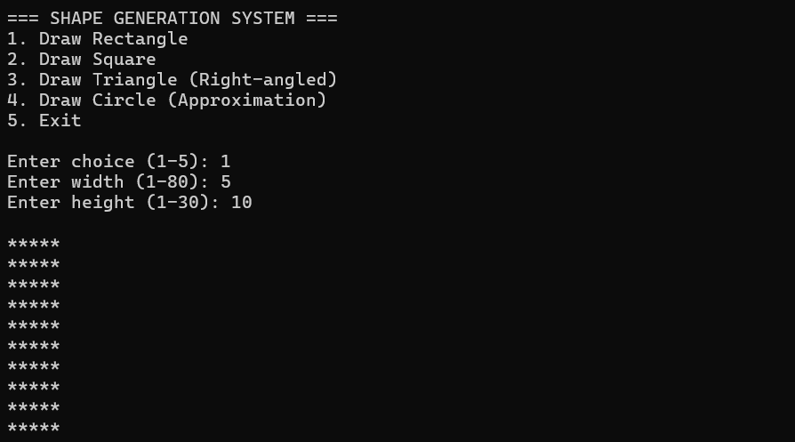
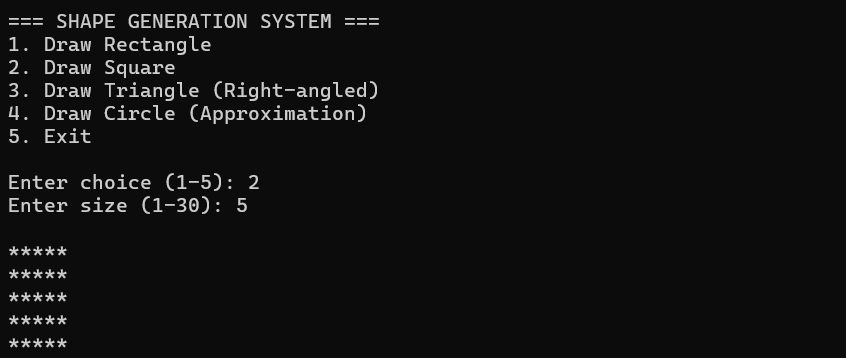
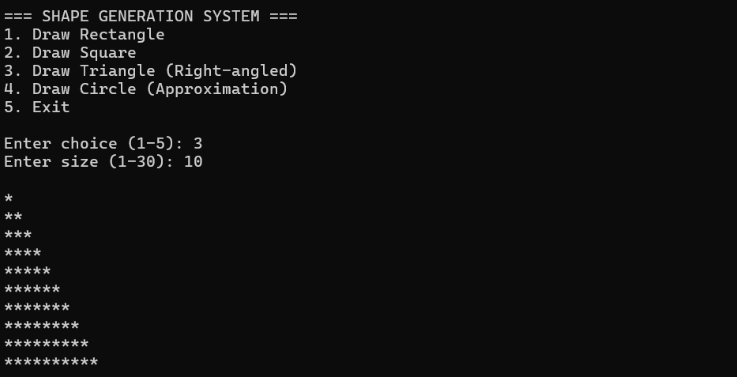
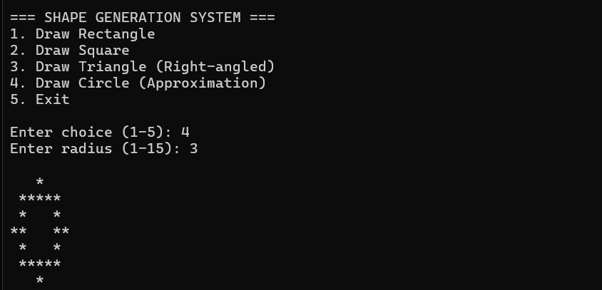
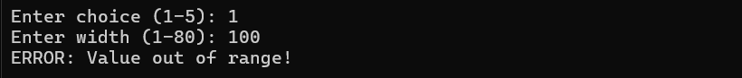
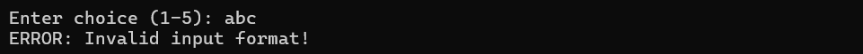

# Shape Generation System: Assembly vs Python

A console program that draws ASCII shapes (rectangle, square, right-angled triangle and a circle outline), written **twice** so the two styles can be compared:

- **`src/shape_generator.asm`**: NASM x86-64 assembly for Linux. It talks to the kernel directly with `sys_read`, `sys_write` and `sys_exit`, with no C library.
- **`src/shape_generator.py`**: the same menu and the same shapes in Python 3.

Built for an Integrated Computer Systems (ICS) assignment at Asia Pacific University (APU). The assignment asked for a working assembly program, plus a research comparison of low-level and high-level code.

## What it does

```
=== SHAPE GENERATION SYSTEM ===
1. Draw Rectangle
2. Draw Square
3. Draw Triangle (Right-angled)
4. Draw Circle (Approximation)
5. Exit
```

| Option | Input | Range |
|---|---|---|
| Rectangle | width, height | 1 to 80, 1 to 30 |
| Square | size | 1 to 30 |
| Triangle | size (height) | 1 to 30 |
| Circle | radius | 1 to 15 |

Wrong input is caught and the menu comes back: `Invalid input format!` for non-numbers, `Value out of range!` for numbers outside the range, and `Invalid choice! Please enter 1-5.` for a bad menu choice.

## Screenshots

| | |
|---|---|
|  |  |
| *Rectangle, width 5 and height 10* | *Square, size 5* |
|  |  |
| *Right-angled triangle, size 10* | *Circle, radius 3* |
|  |  |
| *Input outside the allowed range* | *Input that is not a number* |

## How the assembly version works

- **System calls only.** `print_string` and `print_char` wrap `sys_write`. `read_input` calls `sys_read` and turns the typed digits into a number with a `result = result * 10 + digit` loop, returning `-1` for anything that is not a digit.
- **One routine per job.** Utility routines (`print_string`, `print_char`, `print_newline`, `read_input`), one `draw_*` routine per shape, one `handle_*` routine per menu choice, and shared error handlers, all driven by a `main_loop`.
- **Registers are saved.** Each routine pushes the registers it uses and pops them before returning, so the caller's state survives.
- **Shapes are nested loops.** The rectangle and square print `*` for every column of every row. The triangle prints one more `*` on each row. The circle goes through a square grid of side `2 * radius + 1` and prints `*` where `(radius - 1)² <= dx² + dy² <= radius²`, which draws a ring. The comments call it a midpoint circle algorithm, but it is a simple distance check against two squared radii.

The Python version has the same functions in the same order, so the two files can be read side by side. The assembly file is about 600 lines and the Python file about 125.

## Getting started

### Assembly (64-bit Linux)

You need `nasm` and `ld` (binutils).

```bash
make
./shape_generator
```

Or by hand:

```bash
nasm -f elf64 src/shape_generator.asm -o shape_generator.o
ld shape_generator.o -o shape_generator
```

It makes raw Linux system calls, so it does not run on Windows or macOS. WSL works.

### Python (any OS)

```bash
python3 src/shape_generator.py
```

## Known limitations

- **Fixed 10-byte input read (assembly).** `read_input` reads up to 10 bytes per call. Typing at a terminal works, but piping many lines in at once makes it read several lines as one number. Input longer than 9 characters spills into the next prompt.
- **End of input loops forever (assembly).** If stdin is closed, the menu keeps printing `Invalid input format!`.
- **Stray zero bytes.** The string lengths include the trailing `0`, so a NUL byte is printed after each message. Terminals ignore it.
- **Circle is a ring** drawn on a character grid, so small radii look a little lumpy, and terminal characters are taller than they are wide, so it looks oval.
- The Python file calls `main()` as soon as it is imported, so it is meant to be run, not imported.

## Team

Group O, Integrated Computer Systems (ICS), Asia Pacific University (APU).

| Part | Member |
|---|---|
| Assembly program | [@xiulailai](https://github.com/xiulailai) |
| Research: high-level vs low-level comparison | [@Xylore9](https://github.com/Xylore9) |
| Research: branch prediction and caching | [@WilliamChuah](https://github.com/WilliamChuah) |
| Introduction, conclusion and reflection | [@2FoR1](https://github.com/2FoR1) |

## License

Released under the [MIT License](LICENSE). Copyright (c) 2026 automaticicemaker Contributors and APU.
